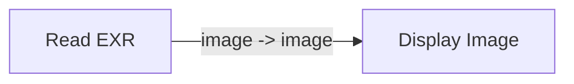
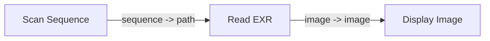
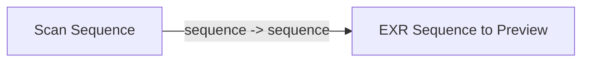
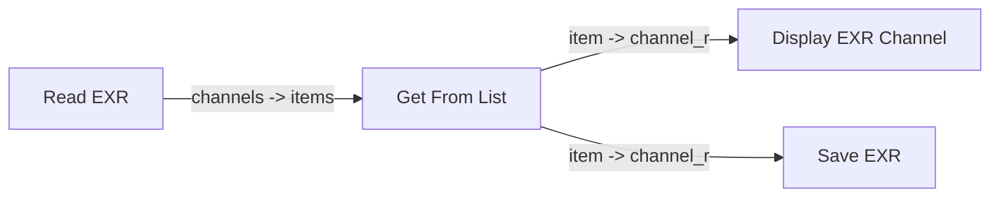

# OpenEXR Library For Griptape Nodes

Read EXR images and frame sequences, preview parts and channels, make review videos,
and save images or floating-point channel data to EXR.

Use **Read EXR** for new reading workflows. **Load EXR** and **Load EXR Sequence** are
deprecated but remain available while their missing capabilities are migrated.
See the [migration guide](docs/migration.md) before changing an existing workflow.

## Getting Started

### Install The Library

1. In Griptape Nodes, open **Manage > Library Management**.
2. Click **Add Library** and paste this repository URL:
   `https://github.com/griptape-ai/griptape-nodes-library-openexr`.
3. Click **Install**, then **Download** in the confirmation dialog.

The examples below use **Display Image**, **Get From List** and **Scan Sequence**
from the standard library. For a managed environment where library installation
is unavailable, ask your administrator to install the library.

### Read An Image Or Inspect A Render Layer

1. Add **Read EXR** and set `path` to an EXR file, such as `/renders/beauty.exr`.
2. Select a part or layer when the file contains more than one.
3. Run the node to see its preview. Adjust `exposure` to bring highlights into view.

To pass the preview to other image nodes, use the `image` output:

The preview is an 8-bit PNG. The `part` and `channels` outputs retain the source
floating-point data. Use those outputs for channel work or saving HDR data.

### Read A Frame Sequence

In **Read EXR**, select a sequence through the File Browser or type a frame
pattern such as `/renders/shot/beauty.####.exr` into `path`. Choose a `frame`
using its actual number on disk. Read EXR renders one frame per execution.

**Scan Sequence** is optional. Connect it when you need control over sequence
discovery and missing-frame policies. Set its **Path or pattern** to the frame pattern:

See [frame sequences](docs/sequences.md) for iteration, frame gaps and video sizing.

### Make A Preview Video

Add **EXR Sequence to Preview**, set `sequence` to
`/renders/shot/beauty.####.exr`, choose `frame_rate` and run it. The default output
is an MP4 at 24 frames per second. It also accepts a connected sequence:

Use the `video` output or the file named by `output_file`.
See [sequence policies](docs/sequences.md#discovery-and-failed-frames) if frames
are missing or have different dimensions.

### Display A Channel Or Save It To EXR

Connect Read EXR's `channels` to **Get From List** and set `index` to the channel
you want. Connect the selected channel to a display slot, a save slot, or both:

This example uses the channel as red. Repeat the selection for green, blue or
alpha as needed. Channel order depends on the source file.

**Save EXR** also accepts an 8-bit image through `image_in`. Use channel inputs to
preserve source floating-point values; saving an 8-bit preview does not recover
its HDR data. Choose `FLOAT` when you need 32-bit storage. The default `HALF` uses
16-bit floating-point storage.

### Choose A Node

| Node                                                                                      | Use it for                                                                                                                |
| ----------------------------------------------------------------------------------------- | ------------------------------------------------------------------------------------------------------------------------- |
| [Read EXR](docs/nodes.md#read-exr)                                                        | Read a file or one sequence frame, select a part or layer, and produce an image.                                          |
| [Display EXR Part](docs/nodes.md#display-exr-part)                                        | Render a part descriptor with its own display settings.                                                                   |
| [Display EXR Channel](docs/nodes.md#display-exr-channel)                                  | Map channels to R/G/B/A, align them or composite over a background.                                                       |
| [Save EXR](docs/nodes.md#save-exr)                                                        | Write an image or selected channels to a single-part EXR.                                                                 |
| [EXR Sequence to Preview](docs/nodes.md#exr-sequence-to-preview)                          | Convert a sequence to an MP4 or MOV review video.                                                                         |
| [Load EXR](docs/nodes.md#load-exr) / [Load EXR Sequence](docs/nodes.md#load-exr-sequence) | Retain deprecated workflows that need metadata, descriptor lists or batch validation. See [migration](docs/migration.md). |

## Library Settings

Configure these settings in the engine's `openexr` category.

| Setting                     | Default    | Purpose                                                                                                                                                                                                                                                      |
| --------------------------- | ---------- | ------------------------------------------------------------------------------------------------------------------------------------------------------------------------------------------------------------------------------------------------------------ |
| `openexr.header_only`       | `true`     | Load EXR scans headers only and labels channel types as `half`. Set to `false` to load pixels and report accurate types. Read EXR reads pixels during execution; its live metadata refreshes scan headers only. Load EXR Sequence always scans headers only. |
| `openexr.max_render_pixels` | `67108864` | Pixel limit for Display EXR Channel and EXR Sequence to Preview output and intermediate canvases, including video padding. Allows an 8192x8192 canvas.                                                                                                       |
| `openexr.viewer_executable` | `""`       | Path to an external HDR viewer. Empty uses the OS default file association.                                                                                                                                                                                  |
| `openexr.viewer_args`       | `""`       | Viewer arguments placed before the file path, parsed with shell-style quoting.                                                                                                                                                                               |

After running a supported node, click **Open in external viewer** to open its
source EXR. The viewer launches without blocking the canvas.

The render limit must be a positive integer. Increase it for larger canvases;
images are never resized to fit. It does not limit Read EXR, Display EXR Part or
source EXR decoding. See [render limits and memory](docs/troubleshooting.md#render-limits-and-memory)
before raising it.

## Links

- [Documentation index](docs/README.md)
- [Node reference](docs/nodes.md): inputs, outputs, defaults and channel alignment.
- [Rendering and colour management](docs/rendering.md): display transforms, overscan, ICC profiles and OpenColorIO.
- [Frame sequences](docs/sequences.md): iteration, missing frames and video canvas policies.
- [Migration guide](docs/migration.md): deprecated nodes, replacements and remaining gaps.
- [Troubleshooting](docs/troubleshooting.md): display, sequence, memory and viewer problems.
- [Development](docs/development.md): setup, tests and fixtures.
- [Contributing](CONTRIBUTING.md): development environments, checks and releases.
- [Changelog](CHANGELOG.md)
- [Report an issue](https://github.com/griptape-ai/griptape-nodes-library-openexr/issues)
