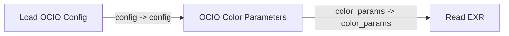

# Rendering and colour management

## OpenColorIO

Basic mode uses the display transforms below. For a pipeline-specific transform,
install the [OpenColorIO library](https://github.com/griptape-ai/griptape-nodes-library-opencolorio).
Connect its colour parameters to the EXR node and set `color_mode` to `ocio`:

Load OCIO Config uses `$OCIO`, or an explicit path set through **Advanced > Override
OCIO Config** and **Config File Path**. In OCIO Color Parameters, select the source
colourspace, display and view. The same `color_params` output can connect to
Display EXR Part, Display EXR Channel or EXR Sequence to Preview.

## Display transforms

In `basic` colour mode, `tone_mapping` selects how scene-linear values are
encoded for display. The names match the views in Nuke's default OCIO config,
so `rec709` and `rec1886` mean the same curves there as they do here.

| Choice    | Curve                                    | Linear 0.18 renders as |
| --------- | ---------------------------------------- | ---------------------- |
| `sRGB`    | sRGB transfer function (IEC 61966-2-1)   | 118                    |
| `rec709`  | BT.709 OETF                              | 104                    |
| `rec1886` | BT.1886, pure gamma 2.4                  | 125                    |
| `raw`     | None. Clamped to [0, 1] with no encoding | 46                     |

`rec709` is darker than `sRGB` through the midtones and `rec1886` is lighter,
because sRGB's effective gamma of roughly 2.2 sits between the two. `raw`
applies no transfer function, which is useful for reading actual pixel values
but looks dark on screen.

Every choice is a pure transfer function, so scene values above 1.0 clip to
white. Nuke's default viewer behaves the same way. Lower the `exposure` to
bring highlights into range, or use `ocio` mode with a config that provides a
tone-mapped view transform such as ACES.

Without an embedded profile, viewers decode the PNG as sRGB, so picking
`rec709` or `rec1886` shows the same mismatch you get when viewing a Rec.709
output on an sRGB monitor. See [Colour profiles](rendering.md#colour-profiles).

> **Note:** `linear` and `filmic` were removed, and workflows still set to
> either fail with an error naming the replacement.
>
> `linear` applied the sRGB transfer function despite its name, making it a
> confusing spelling of `sRGB`. Use `sRGB` to keep the previous output, or
> `raw` for genuinely unencoded linear values.
>
> `filmic` was a Narkowicz 2015 approximation of the ACES RRT, a term from
> Blender and real-time rendering rather than VFX. Basic mode now offers only
> display encodings, matching Nuke's default viewer. Use `sRGB` for a similar
> look, or `ocio` mode for a real tone-mapped view transform.

## Display window

Use `window_mode` to choose which region the node displays. Supported by **Read EXR**, **Display EXR Part**, **Display EXR Channel** and **EXR Sequence to Preview**.

Info: EXR data and display windows

An EXR's _data window_ contains its stored pixels. The _display window_ defines the intended frame. Stored pixels can extend beyond the frame (overscan) or cover only part of it.

| `window_mode`            | Rendered image                                                                                                                                        |
| ------------------------ | ----------------------------------------------------------------------------------------------------------------------------------------------------- |
| `Full` (default)         | Every stored pixel, at the data window's size.                                                                                                        |
| `Crop Overscan`          | The display window's size. Overscan is cropped away, and frame areas with no stored pixels are black, with zero alpha in RGBA output.                 |
| `Show Overscan Boundary` | Every stored pixel, with a dashed black-and-white outline just inside the display window's edge. Edges that fall outside the data window are clipped. |

Only the rendered PNG or video changes. The `part` and `channels` outputs describe the original EXR and retain its data window, display window and source pixels. Downstream display nodes choose their own `window_mode`; set the same mode and intended frame there to match Read EXR's rendered dimensions. Read EXR's `image_width` and `image_height` describe its rendered image, while dimensions on `part` describe the source data window.

The automatic file-level EXR preview uses the data window and receives no node-specific rendering settings. It can show overscan even when Read EXR renders with `Crop Overscan`. This preview is separate from the node's rendered `image` output.

**Load EXR** and **Load EXR Sequence** report both windows as stored. For a sequence, each frame is framed by its own header, so a changing data window renders at one size in `Crop Overscan` mode when the display window stays constant. Workflows saved before this option existed load with `Full`, so they render as they did.

## Colour profiles

By default the written PNG carries no colour profile, so viewers read it as
sRGB whichever transform produced it. That is what makes `rec709` and
`rec1886` look different on screen: the file is encoded with one curve and
decoded with another, the same mismatch you get sending a Rec.709 output to an
sRGB monitor.

Setting `embed_color_profile` writes an ICC profile naming the curve actually
used. The pixels are untouched; only the label changes.

With a profile embedded, all the transforms look the same in a colour-managed
viewer. The application uses the profile to convert the encoded values to your
display, producing the same colour for each transform. The visible difference
between transforms occurs when the profile is missing.

Choose `embed_color_profile` according to how you will use the output:

| `embed_color_profile` | Use for                                                           |
| --------------------- | ----------------------------------------------------------------- |
| `false` (default)     | An on-screen preview that emulates a Rec.709 or BT.1886 monitor.  |
| `true`                | A file another application will open, convert or grade correctly. |

The parameter is hidden in `ocio` colour mode, where the display/view
transform already resolves to a display colorspace we cannot describe.

**Video** is always tagged, and has no `embed_color_profile` parameter. An MP4
cannot carry an ICC profile, so **EXR Sequence to Preview** writes Rec.709
primaries and a matching transfer characteristic into the stream instead.
Players use those tags; without them, the player guesses. In `ocio` colour mode the transfer tag is Rec.709, since the
display/view transform resolves to a colorspace we cannot name.

Alpha is included automatically when an alpha channel (`A`) is found in the part.
